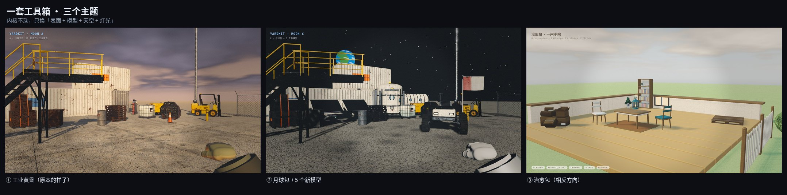

# yardkit



把单文件浏览器 FPS《Saltline》里值得复用的东西，抽成一套能在别的 three.js 项目里直接用的工具：

- **几何**：载具 / 武器 / 敌人 / 道具 / 固定设施 / 集装箱，全部程序化生成，零贴图
- **材质**：30 个 GLSL 表面函数（混凝土、锈铁、瓦楞、草地、泥沙……），零图片
- **搭建**：一套「摆几何 + 同时登记碰撞盒」的关卡工具
- **第一人称**：程序化手部 + 武器挂点（viewmodel）

抽取来源：单文件浏览器 FPS《Saltline》（原始工程不在本仓库内）。

```bash
npm i three@0.180        # peerDependency
node test/check.mjs      # 无 WebGL 自检
npm run demo             # http://127.0.0.1:8177/demos/  （不是 npm 包也能直接跑）
```

---

## 三个入口

```js
import { createProp, createContainer, createLevel } from 'yardkit/geometry';
import { createMaterial, bakeAverage, NAMES } from 'yardkit/materials';
import { createViewModel, createDecal } from 'yardkit';        // 全量
```

| 入口 | 内容 | 依赖 |
|---|---|---|
| `.` | 全部 | three |
| `./geometry` | 模型 + 道具 + 设施 + 容器 + 关卡工具 + 贴花 | three |
| `./materials` | 30 个 GLSL 材质 + 天空 + 后处理 | three（`bakeAverage` 需要 renderer） |

浏览器里裸 `three` 需要 importmap；仓库自带 `vendor/three`（r180），demo 就是这么跑的：

```html
<script type="importmap">
{ "imports": { "three": "./vendor/three/three.module.js", "three/addons/": "./vendor/three/jsm/" } }
</script>
```

---

## 模型

### Hero（展示级）

| 导出 | 内容 |
|---|---|
| `createBoat` / `createCrane` / `createDistantCrane` / `createShip` / `createSeagulls` | 拖船、门座吊、远景吊、集装箱船（`KITTIWAKE`）、海鸥群 |
| `createPAC9` / `createPAC4` | PAC-9「Longshore」步枪 / PAC-4「Bosun」手枪，`userData.parts` + `userData.update` |
| `createHound` / `createGull` | 四足 IK 机械犬 / 带视野锥的海鸥 |

### 道具 19 个 · 设施 14 个

```js
createProp('barrel', { seed: 3, color: 'red' });     // 道具：桶/托盘/板条箱/吨桶/电缆盘/轮胎堆/油桶…
createFixture('guard_booth', { seed: 1 });           // 设施：岗亭/道闸/铁丝网/灯杆/栈桥/钢梯/货架…
createProp(name, opts) / createFixture(name, opts)   // 统一入口
PROP_NAMES / FIXTURE_NAMES                           // 可枚举
```

道具带程序化变化：桶 3 色 × 立/卧/开盖、托盘按种子歪斜破损、纸箱塌角贴胶带印字、锥桶随机倒伏、叉车货叉高度可调。

### 集装箱

```js
createContainer('container20' | 'container40' | 'container40hc', { seed, doors, wear, color })
```

`doors` 是开门程度（0–1），`wear` 是磨损（0–1）；`userData.color / doors / size / colliders`。关箱 1 个碰撞盒，开门 11 个。

### 港区背板（远景组）

```js
createSkyline({ seed })                       // 远景天际线：岸堤、楼群、集装箱垛、灯塔（单 mesh，约 8 万三角形）
createLamps({ specs, posts })                 // 灯杆 / 灯头 / 泛光灯发光片 + 全场闪灯点
createBackdrop({ boat, crane, ship, skyline, lamps, gulls, showcase })
// -> { root, update(dt), boat, crane, ship, skyline, gulls, lamps, colliders, spreader, stats }
```

`update(dt)` 保留原游戏的摆动/雷达/海鸥/灯组闪烁；`colliders` 含 8 个吊机盒 + 4 个船体盒 + 系缆护舷。
任一部件传 `false` 可单独关掉。

### 尺寸与碰撞

所有工厂 `finish()` 时写入：

```js
obj.userData.size;      // [宽, 高, 深]
obj.userData.colliders; // [{ min:[x,y,z], max:[x,y,z], surface:'metal'|'concrete'|'wood'|'rubber'|'dirt'|'water' }]
```

---

## 材质（30 个零贴图 GLSL 表面）

```js
import { createMaterial, bakeAverage, NAMES } from 'yardkit/materials';

const avg = Object.fromEntries(NAMES.map(n => [n, bakeAverage(renderer, n)]));
const floor = new THREE.Mesh(new THREE.PlaneGeometry(40, 40), createMaterial('concrete', { tile: 2.5, avg: avg.concrete }));
```

参数：`tile`（几米一循环）、`bump`（凹凸强度）、`amount`（磨损量，`uP.x`）、`avg`（远处平均色）、`tint`、`cutout`、`side`。
远处会按像素足迹淡出成平均色（这是抗锯齿，不是 bug）。

材质清单与参数表：`docs/MATERIALS.md`；源码：`assets/glsl/*.glsl` → `npm run build:glsl` → `src/materials/glsl.js`（可复现）。

### 与模型的联动

```js
import { createMaterial, bakeAverage, NAMES } from 'yardkit/materials';
import { createMaterialStore, createProp } from 'yardkit/geometry';

const materials = createMaterialStore({ createMaterial, averages });
createProp('barrel', { materials, seed: 3 });   // 道具自动换成 GLSL 材质
```

`YARDKIT_TO_GLSL` 把 43 个 PBR 预设名映射到 30 个 shader（23 个目标，全部命中）。

---

## 配套 skill

`~/.agents/skills/yardkit/` 把做主题包的流程固化成了技能：五件套、内核挂钩、模型约定、
三条验收、并行代理的文件所有权、以及 `docs/LESSONS-MOON.md` 里的坑。做新包或新场景时先读它。

## 主题包（换风格）

内核（图元、批处理、碰撞/规格、材质框架、关卡、贴花）与风格是分开的：
**一个包 = 新表面 + 材质重映射 + 新模型 + 天空/灯光 + 一个 demo**。

| 包 | 内容 | demo |
|---|---|---|
| `packs/moon` | 月壤/月岩/隔热金箔/太阳能板 + 黑天空/地球 + 硬光；复用 40+ 个工业道具 + 5 个新模型（气闸/月球车/太阳能阵列/居住舱/旗） | `demos/moon.html?mode=b\|c` |
| `packs/cozy` | 灰泥/刷漆木/陶/织物/叶簇 + 软光；桌椅、茶杯、书架、盆栽、地毯、灯笼、篱笆 | `demos/cozy-scene.html` |

写新包的完整清单、内核的 4 个挂钩、以及三个必踩的坑：`docs/PACKS.md`。
两个对照实验：`docs/AB-LIGHTING.md`、`docs/EXPERIMENT-MOON.md`。

> 规则：**一个场景只用一个主题包**。混用会读出「废弃工业区」这类非预期风格。

## 关卡搭建

`createLevel()` 是原游戏 `uw(n)` 的库化版本：几何和碰撞盒用同一套世界坐标登记。

```js
const t = createLevel({ materials, seed: 4242 });

t.slab('concrete', -12, 0, -12, 12, 0.08, 12, {});          // 地面
t.col(-12, -0.2, -12, 12, 0.08, 12, 'concrete');            // 碰撞盒
t.slab('concrete_dirty', -12, 0, -12, 12, 2.6, -11.6, {});  // 墙
t.col(-12, 0, -12, 12, 2.6, -11.6, 'concrete');

t.stairs(-6, -4, 0, 0, {});
t.catwalk(-1, -4, 0, 2.6, {}, [true, true]);
t.stack(4.5, -6.5, [[40, 'red', {}], [40, 'blue', {}]]);     // 集装箱堆
t.place('forklift', 2.0, 3.0, -0.9, { seed: 3 });           // 道具/设施（自动带碰撞）

const { root, colliders, stats } = t.build();               // 按材质合并 + 统计
```

方法：`M/MI`（材质）、`add/box/slab/cyl/tube/rod/ibeam/quad`（几何）、`col`（碰撞）、`decal/label`、
`place`（摆道具）、`stack`（集装箱）、`stairs/catwalk`、`isMetal`、`build/dispose`。

`place()` 会把道具自身的 `userData.colliders` 按摆放矩阵变换后登记；旋转过的道具会切条 + 收缩 7%。

> 注意 `mergeGeos()` 只保留 `position / normal / uv / color` 四种属性；自定义 attribute（例如闪灯用的 `blink`）
> 要在合并前处理，或自己写合并（`backdrop.js` 就是这么做的）。

---

## 贴花与文字

```js
import { DECAL_KINDS, createDecal, createLabel } from 'yardkit/geometry';
createDecal('hazard_flammable');   // -> { material, aspect, texture }
createLabel('UN 1202', { color: 'black', font: 'stencil' });
```

18 种贴花与游戏一致：`hazard_flammable / hazard_voltage / hazard_general / arrow / no_entry /
logo_a..d / berth4 / csc_plate / numbers_0_9 / caution_stripes / oil_stain / leak_stain / rust_run / grime_streak / scorch`。

> 原版文字用了一套自带「桥梁/磨损」的 stencil 排版器（依赖字体文件），这里用 canvas `fillText` 做兼容实现：
> 名称、宽高比、用途一致，笔画细节不如原版。

---

## 第一人称（viewmodel）

```js
import { createViewModel, createHandRig, createHand } from 'yardkit';
const vm = createViewModel('pac9');       // -> { root, hands, weapon, update(dt, state), setPose, shot, reload, dispose }
camera.add(vm.root);                      // 建议用一台更窄 FOV 的相机单独渲染
vm.update(dt, { ads: false, trigger: 0, reload: false });
```

- 复用 `createPAC9/createPAC4` 的几何，补手部、握把锚点、后坐/换弹/ADS 弹簧。
- 手是**一张连通的 SDF 等值面网格**（surface nets + 渐变投影 + 蒙皮）：默认 `createHand(side)` 产出单个
  `SkinnedMesh`（35 骨骼、约 4.6k 顶点），`{ surface: 'primitives' }` 可退回「每个图元一个 mesh」的调试形态。
- 手型胶囊/盒体、指节表、姿态表（10 个握把 × 5 个姿态）全部逐字搬运；左手由右手网格镜像 + 重新绑定得到。

与原版的差异（都在 `src/hands.js` 头部写明）：

| 差异 | 说明 |
|---|---|
| 小臂袖套 `mD()` | 未烘进手网格（只有手） |
| 手臂 IK / `createArm` | 未移植，`update(dt, state)` 只驱动手骨与武器 |
| `rest`/`hand` 顶点属性 | 原版用程序化 `armSurface()` shader 上色；这里用逐顶点颜色近似（棕/橄榄/橡胶分区） |
| 手指 IK / 弹匣缠绕搜索 | 未移植，扳机用 `TRIGGER_PULL` 曲线 |

---

## 验证与 demo

```bash
node test/check.mjs    # 无 WebGL：70+ 项工厂/贴花/关卡自检
node test/render.mjs   # headless Chromium：截图写进 shots/，有 console 错误就非 0 退出
```

| demo | 内容 |
|---|---|
| `demos/index.html` | 材质浏览器：30 个 GLSL 表面 × 方块/球/圆板 |
| `demos/cozy.html` | 同一套 shader 换白天色板（草地/泥沙/沙地） |
| `demos/kit.html` | **模型 × 材质**：桶/托盘/叉车/岗亭全部用 GLSL 表面 |
| `demos/scene.html` | 用 `createLevel()` 搭的小院子（76 draw calls / 63 colliders） |
| `demos/backdrop.html` | 港区背板：船、吊机、天际线、灯组（`?cam=crane/ship/boat/wide`） |
| `demos/viewmodel.html` | 第一人称：PAC-9 / PAC-4 + 手部（`?w=pac9|pac4&ads=1&debug=1`） |
| `demos/ab.html` | 打光 A/B：基线 / 夜无实用光 / 夜+工矿灯 / +pmndrs 后处理（`?mode=a\|b\|c\|d`） |
| `demos/moon.html` | **主题包实验**：同一批资产，A 工业黄昏 / B 月球包 / C 月球包+5 个新模型（`?mode=a\|b\|c`），见 `docs/EXPERIMENT-MOON.md` |
| `demos/cozy-scene.html` | **治愈包**：8 个新模型 + 5 种表面 + 软光（见 `docs/PACKS.md`） |
| `demos/moon-scene.html` | **月球基地 demo**（独立、可拖动环绕）：月球包 + 5 个模型 + 复用道具 |

## 文件结构

```
index.js / geometry.js / materials.js   三个入口
src/
  geo.js propUtils.js propKit.js        图元 / 道具工具 / 零碎 helper
  propspec.js                           36 条规格表（尺寸/材质/碰撞表面）
  props.js fixtures.js                  19 道具 + 14 设施
  vehicles.js weapons.js enemies.js     9 个 hero 模型
  containers.js                         集装箱（20/40/40HC）
  level.js                              关卡工具
  decals.js                             18 种贴花 + 文字
  hands.js viewmodel.js                 手部 / 武器挂点
  materials.js                          43 个 PBR 预设 + 材质 store（可接 GLSL）
  materials/                            GLSL 材质系统（materials/registry/glsl/sky/post/noise）
assets/glsl/                            30 个 surf + _dsl
tools/build-glsl.mjs                    生成 src/materials/glsl.js
packs/moon/ packs/cozy/                 两个主题包（表面 + 模型 + 天空 + 灯光）
skills/yardkit/                         配套 AI skill（做新主题包时先读它）
demos/                                  materials gallery / cozy / kit / scene / moon / moon-scene
test/check.mjs                          无 WebGL 自检
test/render.mjs                         headless Chromium 截图验收
shots/                                  验收截图（jpg）
vendor/three/                           three r180（demo 离线用）
docs/                                   PACKS（写包清单）/ LESSONS-MOON（12 条经验）/ 两个实验
NOTICE                                  《Saltline》出处与许可说明
```

---

## 来源与许可
- **Yardkit** 的几何、参数与材质结构抽取自单文件浏览器 FPS《Saltline》（从 claude.ai artifact 取得，原始文档未附许可声明）。
  抽取保留了它的大部分尺寸、命名和程序化做法，重新组织成可独立使用的资产库。详见 `NOTICE`。
- 本仓库的代码按 **MIT** 发布（见 `LICENSE`）。**上游作品的许可状态未明**：如果你要商用，请先确认原作者授权。
- 仓库内不含任何第三方图片/字体；`vendor/three` 为 three.js r180（MIT，见其自带许可）。
- 代码里不少局部变量仍是抽取时的短名（源文件是 1.6 MB 压缩包），改具体模型时按导出名（`createX`）搜索最快。
