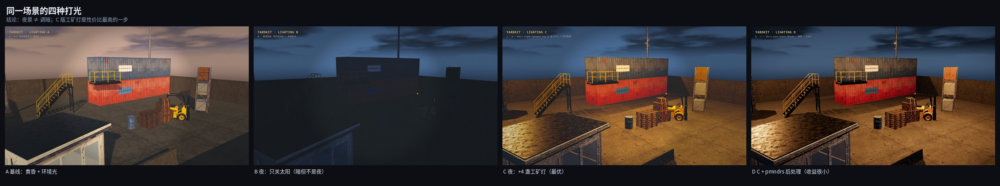

# A/B：给 yardkit 素材换一套打光

同一份几何（`createLevel` 搭的院子 + 集装箱 + 叉车 + 道具 + 灯杆），同一台固定机位，
只改灯光/后处理，四种配置各出一张：

| 面板 | 灯光 | 后处理 |
|---|---|---|
| **A** 基线 | kit demo 的黄昏方案：`createSky` 黄昏色板 + 环境烘焙 2.4 + 方向光 5.4 + 半球 0.6 | kit `createPost`（bloom + ACES + 暗角 + 颗粒） |
| **B** 夜，无实用光 | 同一套夜景 sky/环境（0.55）+ 3dviz `createNightLanternRig` 的月光 0.15 + 半球 0.12，**不加点光** | kit `createPost` |
| **C** 夜 + 实用光 | B + 4 盏工矿灯（420 cd、decay 2、distance 34），灯头位置复用 kit 的 `light_mast` | kit `createPost` |
| **D** C + 3dviz 后处理 | 同 C | 3dviz `post-stack`：bloom(0.9/0.75/0.7) + 暗角 0.4 + ACES exposure 1.05 |

复现：`demos/ab.html?mode=a|b|c|d`（c/d 需要 `npm i -D postprocessing`）。
`demos/_ab/lighting-night-lantern.js`、`demos/_ab/post-stack.js` 原样取自 [viettranx/3dviz-pro-max](https://github.com/viettranx/3dviz-pro-max)（MIT）。

## 结论

1. **B 证明了「夜景 ≠ 调暗」**：只有月光 + 半球补光时画面几乎不可读，地面和道具全糊在一起。
   这是 kit 目前最容易踩的坑——它的材质是「黄昏为主」调的，直接换暗色板会失去层次。
2. **C 是这次唯一有实质收益的一步**：实用光把地面切成几块暖色光池，天空保持冷色，
   集装箱/叉车/托盘立刻有了前后景和呼吸感。代价是 4 个动态点光（其中 2 个开阴影），
   手机端建议降到 2 盏 + 只留 1 张阴影贴图。
3. **D 相对 C 的提升很小**：kit 自己的 `post.js` 已经做了 bloom + ACES + 暗角 + 颗粒，
   两者差别主要是曝光更暖、暗角更重。**不值得为了这一步引入 `postprocessing` 依赖**——
   除非要 DoF、SMAA 这类 pmndrs 独有的效果。
4. 3dviz 这个 skill 对**这个**场景的最大价值不是 rig 本身（74 行、都是常规 three API），
   而是它背后的**决策规则**：月光只画剪影、实用光用物理衰减、按 cd 而不是 0–1 强度给光、
   光池之间留 1/3 重叠。这些已经写进 `demos/ab.js` 的注释里，可以直接抄成项目的打光规范。

## 如果要正式吸收

- 把 `demos/ab.js` 里 C 的灯光配方抽成 `src/lighting.js`：`createNightRig(scene, { lamps })`，
  参数就是 `{ moon, fill, practicals: [{ x, z, y, candela }] }`。
- 保持 kit 的 `createPost`，只在需要景深/抗锯齿时可选接 pmndrs。
- `postprocessing` 继续留在 devDependencies，不进运行依赖。
