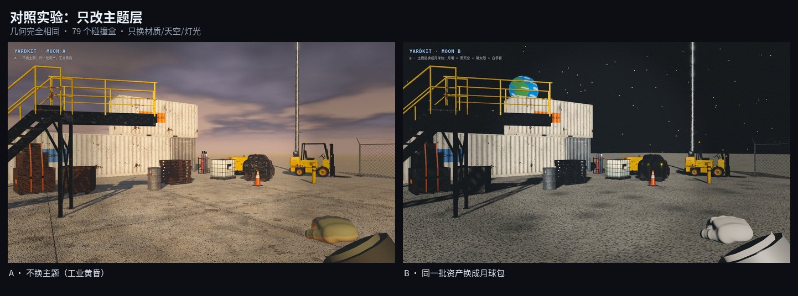

# 对照实验：把 yardkit 的资产"搬到月球"



## 问题

这批资产是**工业港**风格（油桶、集装箱、锈铁、警示条）。如果不改模型，只换"主题层"
（材质 + 天空 + 灯光 + 少量新表面），它能不能读成**月球基地**？

如果能，说明"工具箱 + 主题包"这条路成立：**引擎和资产分层，风格靠包换**。

## 实验设计

- **控制变量**：同一个场景函数、同一个随机种子（2026）、同一台机位、同一套后处理、同一批模型
  （3 个集装箱、叉车、发电机、气瓶、管堆、板条箱、吨桶、篷布货、托盘、油桶、锥桶、钢梯、栈桥、灯杆、围栏、系缆柱 + 一只手）
- **自变量**：只有"主题层"

| | A（对照） | B（月球包） |
|---|---|---|
| 地面 | `concrete` | **`regolith`（新 shader）** |
| 箱体/板材 | `corrugated` / `steel_rust` | **`metal`（光板）** |
| 篷布货 | `tarp` | **`foil`（隔热金箔，新 shader）** |
| 木托盘/纸箱 | `wood` / `cardboard` | **`plastic`（灰色复合材料）** |
| 漆面磨损 | 0.5 | **0.08（月面没有锈）** |
| 天空 | 黄昏渐变 + 云 | **纯黑 + 1800 颗星 + 地球（canvas）** |
| 灯 | 太阳 5.2 + 半球 0.65 + 环境 2.2 | **太阳 4.6（硬）+ 反照 0.055 + 极简环境 0.5** |
| 雾 | 有 | **无（真空）** |
| 手 | 橙色工作手套 | **白色宇航手套 + 袖子** |

## 结果

- 同一批模型，**没有改一行模型代码**，B 能读成"月球基地"：黑天空、地球、灰色月壤、锐利的硬阴影。
- 反过来，A 在同一批模型下就是"码头货场"——说明**风格主要不在模型，而在材质/天空/灯光**。
- 需要补的东西比预想的少：**4 个新 shader**（regolith / moonrock / foil / solar）+
  一张材质重映射表 + 一个黑天空 + 一套硬光 + 压低磨损，约 **200 行**。

## 过程中发现的 4 个技术要点（对"工具箱 + 主题包"很关键）

1. **金属在真空里会变全黑**：没有环境反射，`metalness=1` 的材质就没有亮度。
   所以主题包必须自带一张极简环境（我们加了 `createMoonEnvironment()`：上黑下灰的渐变）。
   这不是 bug，是物理——但它会让"只调灯光"的方案失败。
2. **磨损是主题参数，不是模型属性**：同一批集装箱，`amount` 0.5 是锈迹，0.08 是月尘。
   需要给材质 store 一个"包级预设"（我们在 `installMoonPack()` 里包了一层）。
3. **"材质名 → 表面"的重映射，一次就能换掉 40 个模型的皮肤**：
   我们给 kernel 加了 `createMaterialStore({ surfaceMap })`，十几个映射条目就换了整套道具的外观。
4. **主题包不只有 shader**：宇航员需要一只白手套和一段袖子——这是**新几何**（2 个图元）。
   也就是说：包 = 表面 + 映射 + 天空 + 灯光 + **少量新模型**。

## 为了这个实验，内核改了什么（都很小）

| 改动 | 行数 | 作用 |
|---|---|---|
| `registerSurface(name, glsl, params)` / `surfaceNames()` | ~20 | 主题包在运行时注册自己的表面，不用改内核的 registry/assets |
| `createMaterialStore({ surfaceMap })` | ~3 | 包可以覆盖"道具材质名 → shader"的映射 |

## 结论与限制

- ✅ **方法可迁移**：把"表面 + 映射 + 天空 + 灯光 + 磨损"作为一层，就能给同一批资产换题材。
- ✅ **换题材的成本主要不在引擎**：这次 200 行里，真正花时间的是"月壤长什么样"和"真空里的光比"。
- ⚠️ **轮廓还是工业的**：集装箱的瓦楞、叉车的黄色、锥桶的橙色都在提醒你"这是码头"。
  真要完全变成月球，得做新模型（气闸、月球车、太阳能阵列、舱段）——这就是那 80% 的内容成本。
- ⚠️ 这只手没有小臂（`hands.js` 的已知缺口），实验中用两个图元补了一段袖子。

## 后续：模式 C（月球包 + 5 个新模型）

A/B 证明了"换皮肤"可行，C 用来量"换形状"的代价：

| 模型 | 尺寸 (m) | 顶点 | 说明 |
|---|---|---|---|
| 气闸 `airlock` | 3.1 × 3.4 × 4.1 | 2531 | 筒体 + 门 + 舷窗 + 台阶 + 警示灯 |
| 月球车 `rover` | 2.7 × 2.5 × 2.1 | 3902 | 4 轮 + 座椅 + 小太阳能板 + 天线 |
| 太阳能阵列 `solar_array` | 7.7 × 1.6 × 2.3 | 3810 | 3 块倾斜板 + 支架 |
| 居住舱 `habitat` | 8.0 × 2.7 × 2.2 | 3612 | 带肋圆筒 + 舷窗 + 对接环 |
| 旗 `flag` | 1.8 × 3.3 × 0.8 | 757 | 杆 + 布面（顶点色条纹） |

5 个模型 **367 行**，全部零贴图。这一步花的时间比前面所有 shader 加起来还多，
而且明显还不够（没有月球车座椅细节、太阳板在真空环境里偏黑，见下）。

**代价对比：换表面 ≈ 200 行 / 半天；做 5 个模型 ≈ 370 行 / 一天以上。**

## 复现

```bash
npm run demo            # http://127.0.0.1:8177
# demos/moon.html?mode=a   （工业黄昏，对照）
# demos/moon.html?mode=b   （月球包，同一批模型）
# demos/moon.html?mode=c   （月球包 + 5 个新模型）
```

相关文件：`packs/moon/{surfaces,sky,lighting,index}.js`、`demos/moon.{html,js}`。
